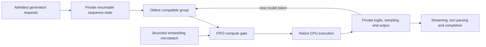

# Native CPU continuous batching

The S6 CPU preview implements `coheryn-cpu-batch-v1`: live compatible generation requests share matrix weight tiles while retaining independent sequence state. New requests can join between model-token units, and completed or failed requests retire independently. This is native multi-vector execution: each matrix tile is read once for the group. The compatibility matrix and qualification records limit which actual files/platforms have been tested.

## Execution and eligibility



A unit advances one model token for each participating sequence, during either prefill or decode. Compatible requests must use the same live model instance, validated graph/tokenizer/storage identity, F32 KV precision, execution settings and I/O tile size. The configured worker count and prefill chunk ceiling are part of that execution identity. Two separately loaded model instances or different execution profiles are not combined merely because their filenames or dimensions match.

Context capacities, prompt lengths, generation limits, positions, samplers, penalties and constraints can differ. Every sequence applies its own RoPE position and causal GQA attention over its own KV. Matrices reuse the admitted tile and apply the same F32/F16/packed arithmetic as individual execution; F16 activation rounding and packed activation quantization remain per vector. No full model dequantization or batch-sized activation copy is introduced. The original single-sequence graph remains the standalone path and the individual-versus-batch comparison baseline.

The [machine-readable profile](../fixtures/batching/profile-v1.json) records the finite bounds. The current scheduler uses a one-token generation quantum even when a profile permits a larger prefill chunk. `prefill_chunk_tokens` remains the configured ceiling; the batching profile identifies the effective scheduling strategy. A sequence that is ready for sampling cannot be advanced again until its existing logits have been consumed. Rust ownership prevents concurrent advancement of the same state.

## Limits and fairness

```sh
coheryn serve --max-concurrency 2 --queue-capacity 8
```

`--max-concurrency` bounds resident generation requests and is capped by available logical CPUs, with a hard maximum of 16. The default remains one; select at least two to permit multi-sequence groups. The waiting request limit defaults to eight, accepts at most 128, and zero permits only immediately admitted work. Atomic admission reserves the complete requested context, private constraints, payload and headroom before queueing. Existing per-model, embedding, session and persistence ceilings still apply.

The coordinator's unit channel holds at most 16 states. Each resident request has at most one outstanding unit. The oldest pending request selects the next model group, and bounded compatible arrivals may join that group; incompatible work retains its order for a subsequent unit. One FIFO compute permit is shared by generation groups and embedding microbatches. Each participant returns it after its bounded tensor work. This prevents an indefinitely generating request from retaining compute ahead of a waiting embedding job. Embedding microbatches also continue to yield to generation.

Balanced generation retains its two-request ceiling. Low-memory generation holds all generation-residency permits, keeping other generation requests queued; embedding units may alternate through the same exclusive compute gate. There is never simultaneous generation/embedding tensor execution under this profile. Memory admission remains global and atomic; mixed-task fairness does not bypass a queue or memory rejection.

Request delivery is outside the shared compute worker. A full token channel or slow/disconnected consumer blocks or cancels only that request. Other eligible requests can continue. Store/history operations retain their separate bounded worker/lease controls. These policies provide bounded-unit task fairness; weighted per-principal guarantees and sustained tail-latency qualification remain open.

## State, failures and memory

KV, scratch, prompt selection, token counts, penalties, RNG, masks, JSON/schema state, tool parsing, stop handling and output remain request-owned. Sampling occurs after the native batch returns the corresponding private logits. Queue order, membership changes and a peer's RNG do not alter that stream. Completed successful managed turns can retain their own qualified prefix cache; caches are never exchanged between lanes.

Cancellation and deadlines are checked per lane between layers, attention work and bounded matrix row groups. A cancelled lane may retain partial private KV until its owning worker acknowledges failure, then releases it. An incomplete schema or output-consumer failure likewise does not invalidate a healthy peer. Changed/truncated model storage is a shared input failure and invalidates the affected model's participants. Other model groups remain independent.

Reservations travel with the state into the coordinator and back to the request worker. Tensor batching lends one participating lane's existing I/O/decode tile to the group and restores it on every returned error path. Other activation/quantization buffers remain private. There is no persistent coordinator workspace or unbounded transition table. Small bounded coordinator handles use the existing conservative session/request allowances. Tokenizer libraries, transport/runtime overhead, allocator behavior and OS thread stacks/residency remain distinct from observed tensor-buffer capacities; `--max-memory` is not an OS-wide cap.

## Diagnostics and placement

Native results expose `batching`; compatible completion/chat responses and terminal SSE chunks include it under `coheryn`. Managed turn results/replays preserve the same metadata under their existing owner checks:

- `profile` and `strategy`: `single-sequence` or `continuous-weight-tiled`.
- `forward_units`, `batched_forward_units`, `maximum_batch_width` and `prefilled_tokens`.
- `scheduler_wait_ms`: time waiting for submitted token units, including the shared compute gate. It excludes the initial request-admission queue and consumer delivery.

Prefill/decode timings sum the sequence's compute units and sampling work. A shared unit's elapsed time belongs to each participating sequence; summing those values is not CPU utilization. First-token timing begins at engine preparation, and delivery time remains separately reported. Initial admission-queue latency and complete stage/allocator instrumentation are not available in this checkpoint.

Admin status/metrics add generation units, multi-lane units, forwarded lanes, maximum batch width, waiting token units, matrix tile reads/bytes and completed embedding microbatches. Unit counters include dispatched attempts; `forwarded_tokens` counts successfully completed model-token lanes, excluding cancelled/failed lanes. Weight-read bytes describe buffered tensor reads, not physical disk I/O or page faults. Counters are aggregate snapshots without prompts, arguments, vectors, session IDs or other owners' content.

`generation_resident_limit` identifies the effective generation ceiling; `configured_active_limit` retains the configured `--max-concurrency` value. `embedding_phase_limit` separately bounds active embedding phases. `active_limit` is their combined upper bound, while `compute_unit_limit` is one; active includes live generation workers and embedding preparation/compute/serialization phases. Counters are diagnostic and do not replace atomic admission.

CPU is the only qualified execution backend. Status reports that selection and a disabled fallback policy. A request is never sent to another executor, changed model, GPU or unqualified task to make it fit. Native vision/Metal and backend-specific batching require their own implementation and evidence.

## Qualification

Ordinary tests cover nonconstant float graph parity, all supported float/packed matrix types, shared-read counts, changing arrival/retirement, request-private sampling/history, cancellation, incomplete constraints, incompatible models/settings, reservation cleanup, actual coordinator packing and both directions of text/embedding progress. Existing session/cache/store/tool/schema/CLI/API regressions remain required.

```sh
./tools/cargo test --workspace --locked --offline
./tools/cargo build --release --workspace --locked --offline
# Opt-in: cached hash-pinned model required; native loopback daemon only.
python3 tools/check_batching.py
python3 tools/check_constraints.py --report fixtures/qualification/s6-constraints-regression.json
```

`fixtures/qualification/s6-service.json` records standalone-versus-batched sequences, dynamic joins/retirements, Unicode constraints, peer RNG, incomplete failures, disconnect cleanup and incompatible execution groups for the exact pinned 0.5B Q4_K_M CPU file. This compares native execution strategies and does not regenerate frozen independent oracle inputs. The S5 contract regression uses the new binary while preserving the original S5 records.

No end-to-end throughput improvement, controlled cold-cache behavior, sustained security/soak result, universal model compatibility, GPU or cross-platform model qualification is inferred from these tests. S6 has an initial CPU checkpoint; full release qualification still requires all mandatory text, vision, embedding, backend and platform evidence.

## Cooperative image phases

The selected native Qwen2-VL adapter now shares the FIFO compute gate through `coheryn-vlm-cooperative-v1`. It yields after joined vision weight tiles, 32-query attention groups and decoder checkpoints, and returns compute during delivery backpressure. Separate bounded phase residency, shared request slots and full atomic reservations permit text/embedding progress while an image request retains its private state. Image requests do not join a shared-weight batched forward pass. [IMAGE_SESSIONS.md](IMAGE_SESSIONS.md) documents the scope, metrics, ownership and remaining weighted-fairness/tail-latency qualification.
